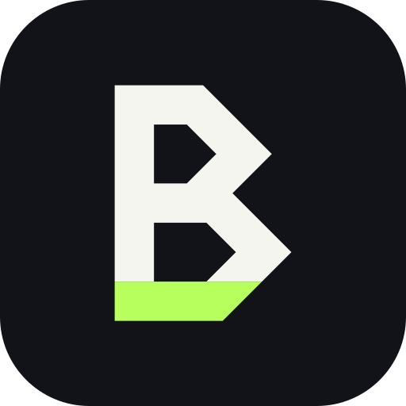

<p align="center">
  
</p>

<p align="center">
  <strong>Every coding contest in one calendar. Practice rooms with friends. Brain games for coders.</strong>
</p>

<p align="center">
  
  
  
  
  
  
</p>

---

**BRUHCODE** is a full-stack competitive programming hub. It pulls upcoming contests from Codeforces, LeetCode, AtCoder, CodeChef and GeeksforGeeks into one calendar, lets friends solve problems together in real-time practice rooms with a live leaderboard, and has Brain Gym quiz games for complexity analysis and debugging.

## Features

### Contest calendar
- Upcoming contests from **Codeforces, LeetCode, AtCoder, CodeChef and GeeksforGeeks**, fetched automatically when the server starts.
- Month and week calendar views.
- Contest list with filters by platform and time (today, this week, this month).
- Countdown timers and contest detail pages with direct links.
- Save contests to your profile so you never miss a round.

### Practice rooms
- Create a room from a contest, set a duration, and share the **invite code** with up to 10 friends.
- Lobby → live round → summary, with a server-side synced timer.
- **Live leaderboard** ranked by problems solved, then by time.
- Per-problem discussion threads that stay **locked until you solve the problem**, so there are no spoilers.
- Real-time presence, progress and chat over SignalR.

### Brain Gym
- **Complexity Quiz**: guess the time complexity of a code snippet.
- **Debug the Code**: find the bug before the timer runs out.
- Personal stats, rank and a global leaderboard for each game.

### Accounts
- Register and log in with JWT authentication.
- Codeforces handle validation at sign-up.
- Password reset with an emailed one-time code.
- Profile and settings pages, plus a rate-limited contact form.

## Tech stack

| Layer | Technology |
|---|---|
| Frontend | React 19, React Router, Tailwind CSS, Framer Motion, FullCalendar, TanStack Query, Zustand, Axios |
| Backend | ASP.NET Core (.NET 10) Web API, SignalR, JWT Bearer auth, built-in rate limiting |
| Database | PostgreSQL with Entity Framework Core (Npgsql) |
| Contest data | Codeforces API, LeetCode GraphQL, CodeChef API, AtCoder pages, Playwright (GeeksforGeeks) |
| Email | MailKit (SMTP) |
| Tests | xUnit with the EF Core in-memory provider |

## Project structure

```
bruhcode-platform/
├── Backend/              ASP.NET Core API
│   ├── Controllers/      Auth, Contests, Rooms, Games, BrainGym, User, Stats, Contact
│   ├── Hubs/             SignalR hub for practice rooms
│   ├── Models/           EF Core entities
│   ├── Data/             AppDbContext
│   ├── Services/         Contest fetchers, seeders, room timer, email
│   └── Migrations/
├── Backend.Tests/        xUnit tests for rooms and thread locking
├── frontend/             React app (Create React App)
│   ├── public/
│   └── src/
│       ├── pages/        Home, Calendar, Rooms, Brain Gym, Profile, ...
│       ├── components/
│       ├── context/      Auth context
│       ├── store/        Zustand room store
│       └── utils/        SignalR client, calendar helpers
├── branding/             Logo files and the script that generates them
└── bruhcode-platform.sln
```

## Getting started

### Prerequisites
- [.NET 10 SDK](https://dotnet.microsoft.com/download)
- [Node.js](https://nodejs.org/) 18 or newer
- [PostgreSQL](https://www.postgresql.org/download/) running locally

### 1. Configure the backend

Settings live in `Backend/appsettings.json`. Keep real passwords and keys out of git by storing them with .NET user secrets:

```bash
cd Backend
dotnet user-secrets init
dotnet user-secrets set "ConnectionStrings:DefaultConnection" "Host=localhost;Database=bruhcode;Username=postgres;Password=YOUR_PASSWORD"
dotnet user-secrets set "Jwt:Key" "a-long-random-secret-at-least-32-characters"
```

Password-reset emails need SMTP settings (`Smtp:Host`, `Smtp:Port`, `Smtp:Username`, `Smtp:Password`, `Smtp:From`), set the same way.

### 2. Run the backend

```bash
dotnet run --project Backend
```

The API starts at `http://localhost:5163`. On first run it creates the database tables, then fetches contests and seeds the Brain Gym questions in the background.

GeeksforGeeks contests are scraped with Playwright. To enable them, install its browser once after the first build:

```bash
pwsh Backend/bin/Debug/net10.0/playwright.ps1 install chromium
```

### 3. Run the frontend

```bash
cd frontend
npm install
npm start
```

The app opens at `http://localhost:3000`. It reads the API address from `frontend/.env`:

```
REACT_APP_API_URL=http://localhost:5163
```

### 4. Run the tests

```bash
dotnet test
```

## API overview

| Area | Base route | Highlights |
|---|---|---|
| Auth | `/api/auth` | register, login, username/email/Codeforces validation, password reset |
| Contests | `/api/contests` | list, upcoming, filter, details |
| User | `/api/user` | profile, saved contests, change password |
| Rooms | `/api/rooms` | create, join by invite code, progress, leaderboard, messages, summary |
| Brain Gym | `/api/games`, `/api/braingym` | questions, submit score, stats, rank, leaderboard |
| Stats | `/api/stats` | platform usage, members, growth |
| Contact | `/api/contact` | contact form (5 per hour per IP) |
| Realtime | `/hubs/room` | SignalR hub for rooms |

## Brand

<p>
  
  &nbsp;&nbsp;
  
</p>

The symbol is a "B" built from two `>` prompt chevrons, with a lime `_` cursor as its base. All logo files (SVG and PNG) are in [`branding/`](branding/). To change them, edit [`branding/build.mjs`](branding/build.mjs) and run `node branding/build.mjs`.

| Color | Hex |
|---|---|
| Charcoal | `#111318` |
| Neon lime | `#B6FF5C` |
| Off-white | `#F5F5F0` |
| Muted gray | `#8A8F98` |

## License

[MIT](LICENSE) © 2026 Riyad
